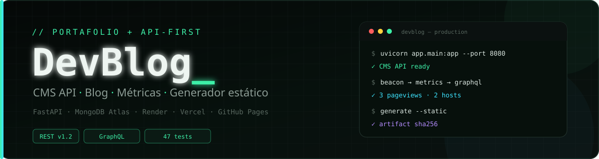
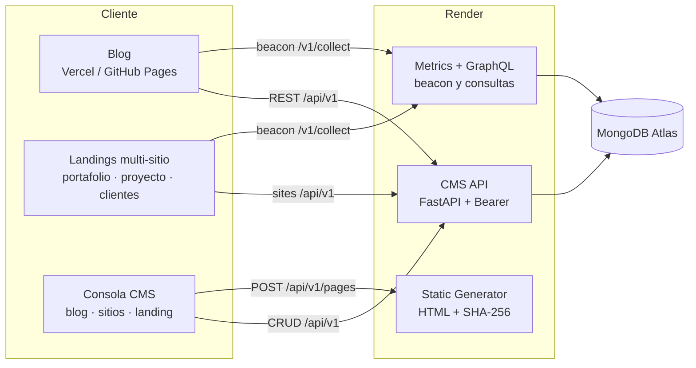

<div align="center">



<br>

<a href="https://mi-landing-devblog.vercel.app/">
  
</a>
<a href="https://mi-blog-dev.vercel.app/">
  
</a>
<a href="https://devblog-cms-leonardo.onrender.com/docs">
  
</a>
<a href="https://devblog-metrics-leonardo.onrender.com/v1/query">
  
</a>
<a href="https://devblog-generator-leonardo.onrender.com/docs">
  
</a>
<a href="#pruebas">
  
</a>

# DevBlog_

**CMS API-First + blog + landings multi-sitio + métricas GraphQL + generador estático.**

Proyecto de Aplicaciones Web construido con FastAPI, MongoDB Atlas, Render,
Vercel y GitHub Pages.

[Portafolio](https://mi-landing-devblog.vercel.app/) ·
[Blog](https://mi-blog-dev.vercel.app/) ·
[Consola CMS](https://mi-blog-dev.vercel.app/admin.html) ·
[API](https://devblog-cms-leonardo.onrender.com/docs)

</div>

---

## Demo en vivo

| Recurso | URL |
|---|---|
| Portafolio | <https://mi-landing-devblog.vercel.app/> |
| Landing del proyecto | <https://mi-landing-devblog.vercel.app/sitio.html?site=devblog-project> |
| Blog | <https://mi-blog-dev.vercel.app/> |
| Consola CMS | <https://mi-blog-dev.vercel.app/admin.html> |
| CMS API / Swagger | <https://devblog-cms-leonardo.onrender.com/docs> |
| Métricas / GraphiQL | <https://devblog-metrics-leonardo.onrender.com/v1/query> |
| Generador / Swagger | <https://devblog-generator-leonardo.onrender.com/docs> |

## Arquitectura



## Módulos

| Módulo | Capacidades |
|---|---|
| **CMS API** | Posts y borradores, sitios, landings, publicidad, media y métricas. UUIDv7, slugs, cursores, idempotencia, rate limit, ETag/304 y errores uniformes. |
| **Blog** | Portada dinámica, artículo por slug, Markdown seguro, vistas y respaldo estático. |
| **Multi-sitio** | Portafolio, landing del proyecto, blog y landings de clientes con contenido, tema y publicación independientes. |
| **Videos** | URL o archivo subido (MP4/WebM/MOV, 25 MB), póster, subtítulos VTT, YouTube/Vimeo y CTA. |
| **Consola CMS** | Dashboard, sitios, editor con portada/SEO/tipografía/índice, publicidad, métricas y exportación Markdown/JSON. |
| **Métricas** | Beacon, pageviews, sesiones, visitantes únicos, rutas, hosts y consultas GraphQL. |
| **Generador** | HTML estático a partir de una instantánea del artículo, con checksum SHA-256. |

## API principal

| Área | Endpoints |
|---|---|
| Blog | `GET /api/v1/posts`, `GET /api/v1/posts/slug/{slug}`, `POST /api/v1/posts/{id}/views` |
| CMS | `GET/POST /api/v1/drafts`, `GET/PUT/DELETE /api/v1/drafts/{id}`, `POST /api/v1/drafts/{id}/publish` |
| Sitios | `GET /api/v1/sites`, `GET /api/v1/sites/{site_id}/landing`, `PUT /api/v1/sites/{site_id}/landing/draft` |
| Landing | `GET /api/v1/landing`, `GET /api/v1/ads`, `GET /api/v1/metrics/overview` |
| Media | `POST /api/v1/media`, `GET /api/v1/media/{media_id}` |
| Generador | `POST /api/v1/pages` en el servicio de generación |

## Estructura

```text
mi-blog-dev/
├── API/devblog-cms-api-1.2/devblog-cms-api/   # CMS FastAPI
├── dev-blog/                                  # Blog, consola y assets del CMS
├── pendiente/
│   ├── metrics-navigation-main/               # Colector de métricas + GraphQL
│   └── static-sites-generator-main/           # Generador estático
├── docs/banner.svg
├── render.yaml
├── setup.ps1
├── start-all.ps1
└── README.md
```

## Stack

`Python 3.12` · `FastAPI` · `Pydantic` · `MongoDB Atlas` / `SQLite` ·
`JavaScript vanilla` · `Render` · `Vercel` · `GitHub Pages` · `GitHub Actions`

## Pruebas

| Suite | Resultado |
|---|---|
| CMS (contrato + Mongo + contenido + sitios + media) | **64 / 64** |
| Métricas | **13 / 13** |
| Generador estático | **4 / 4** |
| **Total** | **81 / 81** |

## Autor

**Leonardo Nucamendi Ruiz**  
Estudiante de Ing. en Tecnologías de la Información e Innovación Digital · México

[GitHub](https://github.com/Leonardo251207) ·
[LinkedIn](https://www.linkedin.com/in/leonardo-nucamendi-703b48441/) ·
[Portafolio](https://mi-landing-devblog.vercel.app/)

---

<div align="center">
  <sub>Hecho con intención · 2026</sub>
</div>
