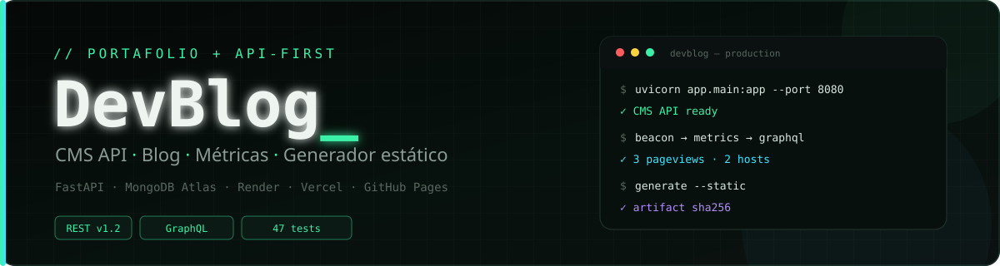
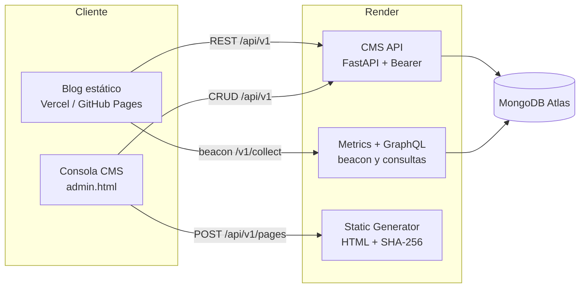

<div align="center">



<br>

<a href="https://mi-blog-dev.vercel.app/">
  
</a>
<a href="https://leonardo251207.github.io/mi-blog-dev/">
  
</a>
<a href="https://devblog-cms-leonardo.onrender.com/docs">
  
</a>
<a href="https://devblog-metrics-leonardo.onrender.com/v1/query">
  
</a>
<a href="https://devblog-generator-leonardo.onrender.com/docs">
  
</a>
<a href="#pruebas">
  
</a>

# DevBlog_

**CMS API-First + blog estático + métricas con GraphQL + generador de HTML estático.**

Proyecto de Aplicaciones Web construido con FastAPI, MongoDB Atlas, Render,
Vercel y GitHub Pages.

[Demo en Vercel](https://mi-blog-dev.vercel.app/) ·
[Demo en GitHub Pages](https://leonardo251207.github.io/mi-blog-dev/) ·
[Guía local](docs/GUIA_LOCAL.md) ·
[Despliegue](DEPLOY_RENDER.md)

</div>

---

## Demo en vivo

| Recurso | URL |
|---|---|
| Blog en Vercel | <https://mi-blog-dev.vercel.app/> |
| Blog en GitHub Pages | <https://leonardo251207.github.io/mi-blog-dev/> |
| Consola CMS | <https://mi-blog-dev.vercel.app/admin.html> |
| CMS API / Swagger | <https://devblog-cms-leonardo.onrender.com/docs> |
| Métricas / GraphiQL | <https://devblog-metrics-leonardo.onrender.com/v1/query> |
| Generador / Swagger | <https://devblog-generator-leonardo.onrender.com/docs> |

> La consola pide el `CMS_CONSOLE_TOKEN` generado en Render. Los servicios
> gratuitos de Render se duermen sin tráfico: la primera petición puede tardar
> 30–60 s.

## Arquitectura



## Lo que incluye

| Módulo | Qué hace |
|---|---|
| **CMS API** | 12 endpoints para borradores y publicaciones. UUIDv7, slug único, cursor firmado, idempotencia, rate limit, ETag/304 y errores uniformes. |
| **Blog** | Portada dinámica, artículo por slug, Markdown seguro, registro de vistas y respaldo estático si la API no responde. |
| **Consola CMS** | Crear, editar, publicar y eliminar artículos; métricas; vista previa Markdown y generación de HTML estático. |
| **Métricas** | Beacon ligero, pageviews, sesiones, rutas, hosts y consultas GraphQL. |
| **Generador** | Convierte una instantánea del artículo en un artefacto HTML con checksum SHA-256. |
| **Documentación** | Contrato v1.2, Anexo D de implementación y guías de despliegue. |

## Stack

`Python 3.12` · `FastAPI` · `Pydantic` · `MongoDB Atlas` / `SQLite` ·
`JavaScript vanilla` · `Render` · `Vercel` · `GitHub Pages` · `GitHub Actions`

## Empieza en local

```powershell
git clone https://github.com/Leonardo251207/mi-blog-dev.git
cd mi-blog-dev
.\setup.ps1
.\start-all.ps1
```

Abre <http://127.0.0.1:5500/> y la consola en
<http://127.0.0.1:5500/admin.html> con `console-dev-token`.

> Si PowerShell bloquea scripts:
> `Set-ExecutionPolicy -Scope Process -ExecutionPolicy Bypass`

La guía completa de puertos, tokens, estructura y pruebas está en
[`docs/GUIA_LOCAL.md`](docs/GUIA_LOCAL.md). Para publicarlo en internet:
[`DEPLOY_RENDER.md`](DEPLOY_RENDER.md).

## Pruebas

| Suite | Resultado |
|---|---|
| CMS (contrato + Mongo) | **47 / 47** |
| Métricas | **13 / 13** |
| Generador estático | **4 / 4** |
| **Total** | **64 / 64** |

```powershell
cd API\devblog-cms-api-1.2\devblog-cms-api
.venv\Scripts\python.exe -m pytest -q
```

## Documentación

- [Guía local y de integración](docs/GUIA_LOCAL.md)
- [Despliegue en Render + MongoDB Atlas](DEPLOY_RENDER.md)
- [Servicios del ecosistema](pendiente/README_DESPLIEGUE.md)
- [README del CMS](API/devblog-cms-api-1.2/devblog-cms-api/README.md)
- [Contrato + Anexo D (PDF)](API/Especificacion_API_CMS_DevBlog_v1.2_implementacion.pdf)
- [Contrato + Anexo D (DOCX)](API/Especificacion_API_CMS_DevBlog_v1.2_implementacion.docx)
- [`render.yaml`](render.yaml)

## Autor

**Leonardo Nucamendi Ruiz**  
Estudiante de Ing. en Tecnologías de la Información e Innovación Digital · México

[GitHub](https://github.com/Leonardo251207) ·
[LinkedIn](https://www.linkedin.com/in/leonardo-nucamendi-703b48441/) ·
[DevBlog_](https://mi-blog-dev.vercel.app/)

---

<div align="center">
  <sub>Hecho con intención · 2026</sub>
</div>
