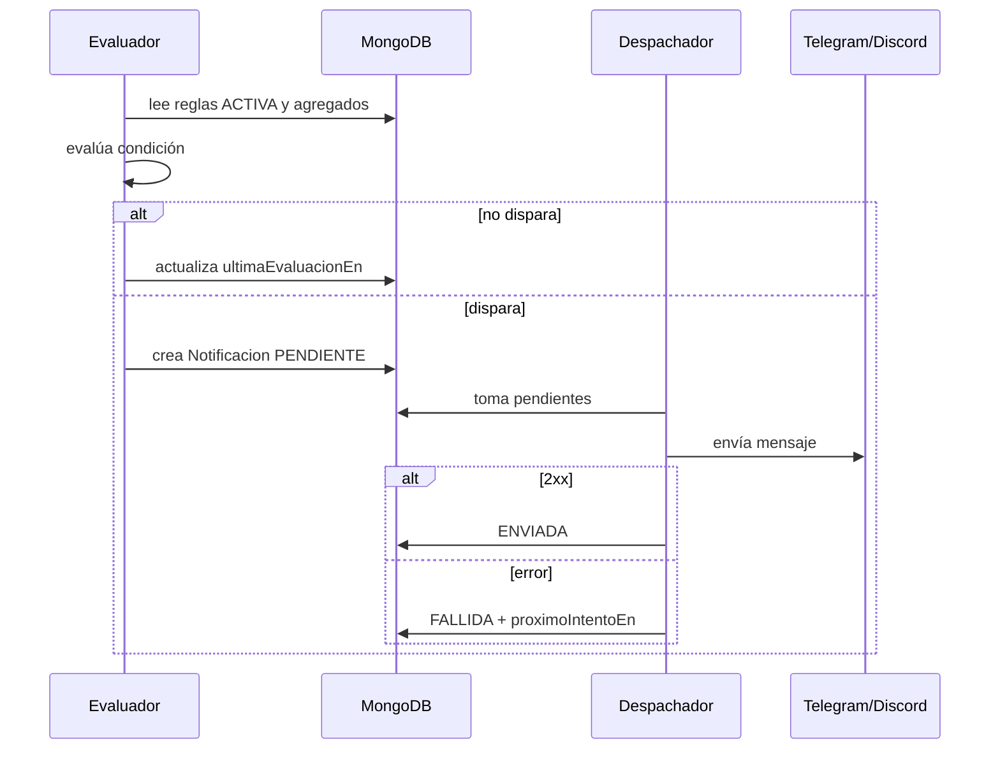

# Alertas: enterarte sin mirar el panel

> El panel sirve para explorar. Las alertas sirven para no tener que explorar. Una alerta es
> una regla que dice: "si pasa esto, avísame por aquí". Sin reglas, el sistema observa pero no
> te enteras de nada.

---

## 1. Qué es una alerta (y qué no)

Una alerta **no** es un reporte. Es una excepción:

- Reporte: "ayer hubo 1.200 pageviews". Lo miras cuando quieres.
- Alerta: "el canal de EC2 lleva 30 minutos sin enviar nada". Te llega sin pedirlo.

Regla de oro: **si no puedes hacer nada con el aviso, no es una alerta; es ruido.** Un bot
nuevo que solo pasó una vez no justifica un mensaje. Una caída de tráfico del 60 %, sí.

---

## 2. Anatomía de una regla

Toda regla tiene seis piezas:

| Pieza | Pregunta | Ejemplo |
|-------|----------|---------|
| **Tipo** | ¿Qué se vigila? | Ausencia de señal |
| **Métrica o sujeto** | ¿Sobre qué? | `pageviews` del sitio `ec2` |
| **Condición** | ¿Cuándo dispara? | 0 eventos en 30 minutos |
| **Ventana** | ¿En qué periodo? | Últimos 30 minutos |
| **Severidad** | ¿Cuánto importa? | `AVISO` |
| **Destino** | ¿Dónde avisa? | Telegram |

Y dos piezas de control:

- **Silencio** (`silencioMinutos`): tras disparar, no vuelve a avisar hasta que pase.
- **Estado**: `ACTIVA`, `SILENCIADA` o `ARCHIVADA`.

---

## 3. Tipos de regla

### 3.1 `UMBRAL` — cruzó un valor

Sirve para métricas con un límite claro.

- `agent_requests > 1.000` en 1 hora.
- `synthetic_latency_p95 > 2.500 ms` durante 15 minutos.
- `error_5xx_rate > 0,01` durante 15 minutos.

### 3.2 `AUSENCIA` — dejó de llegar señal

La más valiosa al principio. Detecta que el sistema está ciego, no que el negocio vaya mal.

- Sin eventos de `ec2` en 30 minutos.
- Sin visitas de edge de `vercel` en 2 horas.
- Sin respuesta de la sonda sintética en 5 minutos.

### 3.3 `ANOMALIA` — se desvió de su historia

Compara con una línea base móvil.

- Pageviews 50 % por debajo de la mediana de los últimos 7 días.
- Peticiones de un agente 3 veces por encima de su media.
- `ad_clicks` sube sin subir `ad_impressions` (posible fraude, cuando haya anuncios).

### 3.4 `ESTADO` — cambió un estado

- Un canal pasó a `DEGRADADO`.
- Una integración pasó a `ERROR`.
- Apareció un dominio nuevo en `PENDIENTE`.

### 3.5 `AGENTE_NUEVO` — apareció un UA desconocido

- Un agente no registrado hace más de 100 peticiones por minuto.
- Un UA que se declara Googlebot no supera la verificación.
- Un mismo hash de IP cambia de UA repetidamente.

---

## 4. Destinos

### 4.1 Telegram (recomendado para uso personal)

1. Habla con `@BotFather` en Telegram y ejecuta `/newbot`.
2. Guarda el token que te da.
3. Crea un chat o grupo y añade el bot.
4. Obtén el `chat_id` (con `@userinfobot` o llamando a `getUpdates`).
5. En el `.env`:

```dotenv
TELEGRAM_BOT_TOKEN=123456:ABC...
TELEGRAM_CHAT_ID=123456789
```

6. Prueba con el comando `probarNotificacion`.

### 4.2 Discord (recomendado para un equipo)

1. Ajustes del servidor → Integraciones → Webhooks → Nuevo webhook.
2. Elige el canal y copia la URL.
3. En el `.env`:

```dotenv
DISCORD_WEBHOOK_URL=https://discord.com/api/webhooks/...
```

4. Prueba con `probarNotificacion`.

### 4.3 Webhook genérico

Para conectar con Slack, ntfy, un script propio o un sistema de incidencias. La API envía un
JSON pequeño y espera `2xx`. Si no llega, reintenta.

---

## 5. Antirruido

El fallo más común de un sistema de alertas es avisar demasiado. Estas cuatro piezas lo evitan:

1. **Silencio por regla.** Por defecto 30 minutos. Una caída de 2 horas genera un aviso, no
   120.
2. **Clave de deduplicación.** `hash(regla, ventana, sujeto)` impide dos mensajes idénticos.
3. **Severidad.**
   - `INFO`: solo al panel, nunca a Telegram.
   - `AVISO`: Telegram/Discord en horario normal.
   - `CRITICO`: siempre, incluso de madrugada.
4. **Horario de silencio.** Un canal puede no enviar `INFO`/`AVISO` entre 23:00 y 08:00.

Y una decisión de diseño: **las alertas se evalúan sobre agregados, no sobre cada evento.**
Evaluar cada pageview sería caro y produciría ruido.

---

## 6. Modelo de datos

| Entidad | Campos clave |
|---------|--------------|
| `ReglaDeAlerta` | `id, propiedad, nombre, tipo, metrica, condicion, ventana, agregacion, severidad, canales[], silencioMinutos, estado, ultimaEvaluacionEn` |
| `CanalDeNotificacion` | `id, tipo (TELEGRAM · DISCORD · WEBHOOK), destino, referenciaSecreto, estado, ultimaEntregaEn` |
| `Notificacion` | `id, regla, ocurrioEn, titulo, cuerpo, severidad, estado, intentos, proximoIntentoEn, claveDeduplicacion` |

Estados de `Notificacion`: `PENDIENTE → ENVIADA | FALLIDA → ENVIADA | DESCARTADA`.

El secreto (token del bot o URL del webhook) se referencia desde el `.env` o el gestor de
secretos; nunca se guarda en claro en la base de datos ni se escribe en logs.

---

## 7. Flujo



Reintentos: 1 minuto, 5 minutos, 15 minutos. Tras cinco intentos, `DESCARTADA` y se registra
en auditoría. Un destino caído no bloquea a los demás.

---

## 8. Ejemplos para los tres proyectos

| Nombre | Tipo | Condición | Severidad | Destino |
|--------|------|-----------|-----------|---------|
| `ec2_sin_senal` | AUSENCIA | 0 eventos en 30 min | CRITICO | Telegram |
| `vercel_edge_caido` | AUSENCIA | 0 visitas de edge en 2 h | AVISO | Discord |
| `pages_trafico_anomalo` | ANOMALIA | −50 % vs mediana 7 d | AVISO | Telegram |
| `lcp_alto` | UMBRAL | `web_vital_lcp_p75 > 2500 ms` 15 min | AVISO | Discord |
| `agente_nuevo_agresivo` | AGENTE_NUEVO | > 100 req/min sin registrar | AVISO | Telegram |
| `dominio_nuevo` | ESTADO | dominio en `PENDIENTE` | INFO | Panel |
| `integracion_rota` | ESTADO | integración en `ERROR` | CRITICO | Telegram |
| `ads_clicks_raros` | ANOMALIA | clics suben sin impresiones | INFO | Panel |

Los dos primeros son los que más valor dan al principio: te avisan de que el sistema está
ciego, no de que el negocio vaya mal.

---

## 9. Lo que no se alerta

- Cada pageview o cada visita de bot.
- Cada deploy o cada preview de Vercel.
- Métricas de una integración que no existe.
- Nada que no tenga una acción asociada.

Si un aviso no cambia lo que haces, sobra.

---

## 10. Fase

Las alertas son **F4**. Antes hacen falta F1 (captura), F2 (agentes) y F3 (panel). Sin datos
fiables, una alerta solo automatiza el ruido.

La única excepción es la alerta de **ausencia de señal**, que puede entrar en F1 porque valida
la propia instalación.
