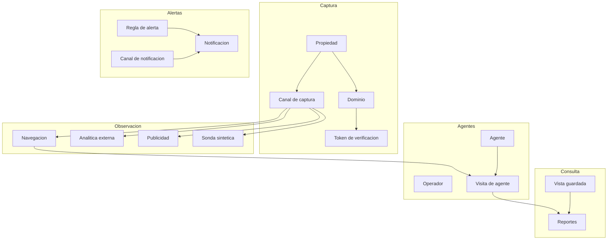
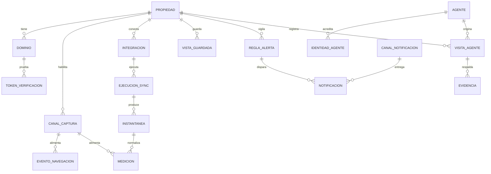

# Modelo definitivo — Metrics Collector & Retriever

> Documento canónico. Describe el sistema completo: dominio, estados, métricas, datos,
> superficie de consulta, alertas, retención, configuración y despliegue.
>
> **Estado:** decisiones cerradas. F1 implementado: propiedades, dominios, canales, beacon y
> reporte de tráfico. El resto de módulos sigue el mismo contrato.
>
> **Fuera de alcance:** monetización de agentes y bloqueo activo en el edge. Se observa
> primero; se decide después.

## Índice

1. [Resumen](#1-resumen)
2. [Alcance](#2-alcance)
3. [Caso de uso: tres proyectos con dominios cambiantes](#3-caso-de-uso-tres-proyectos-con-dominios-cambiantes)
4. [Principios](#4-principios)
5. [Contextos del dominio](#5-contextos-del-dominio)
6. [Entidades y relaciones](#6-entidades-y-relaciones)
7. [Estados y transiciones](#7-estados-y-transiciones)
8. [Catálogo de métricas y cobertura](#8-catálogo-de-métricas-y-cobertura)
9. [Flujos](#9-flujos)
10. [Modelo de datos](#10-modelo-de-datos)
11. [Superficie de consulta](#11-superficie-de-consulta)
12. [Alertas y notificaciones](#12-alertas-y-notificaciones)
13. [Reglas de negocio](#13-reglas-de-negocio)
14. [Retención, explicada](#14-retención-explicada)
15. [Bloqueo en el edge, explicado](#15-bloqueo-en-el-edge-explicado)
16. [Monetización: fuera de alcance](#16-monetización-fuera-de-alcance)
17. [Configuración](#17-configuración)
18. [Decisiones de arquitectura](#18-decisiones-de-arquitectura)
19. [Fases y decisiones cerradas](#19-fases-y-decisiones-cerradas)

---

## 1. Resumen

Una API privada que:

- observa el tráfico de varios sitios, propios o ajenos, con **cobertura declarada**;
- captura personas con un snippet y bots con edge o logs;
- importa métricas de terceros **solo si existe cuenta y credencial**;
- registra, verifica y clasifica visitas de agentes de IA;
- emite **alertas** a un panel interno y a Telegram o Discord;
- expone todo por una **superficie de consulta** tipada, con procedencia explícita.

No es un CRM, ni un CMS, ni un panel editorial. Es infraestructura de observación.

---

## 2. Alcance

**Dentro**

- Captura de navegación propia: pageviews, sesiones, engagement, scroll, web vitals, referrers, UTM.
- Captura de peticiones en el edge o en logs: agentes, rutas, códigos, bytes, latencia.
- Registro de dominios como alias cambiantes de una propiedad.
- Registro y verificación de agentes de IA.
- Clasificación de visitas con evidencia auditable.
- Cobertura por sitio: qué se puede medir y qué no.
- Reglas de alerta con entrega por Telegram, Discord o webhook.
- Consulta unificada con procedencia, completitud y frescura.

**Fuera**

- La web, el CMS y cualquier interfaz visual. El panel interno es un **consumidor** de la API.
- El edge/CDN que ejecuta bloqueos. La API puede publicar política; no la aplica.
- Monetización, precios, facturación y cobro.
- Compra de medios, atribución publicitaria avanzada, MMM.
- Data warehouse / BI.

---

## 3. Caso de uso: tres proyectos con dominios cambiantes

Cada proyecto es una **propiedad** distinta. No comparten datos, claves ni agregados. Los
slugs de la tabla son ejemplos: se pueden renombrar sin perder historia.

| Propiedad | Host típico | Estabilidad | Canales | Qué se obtiene |
|-----------|-------------|-------------|---------|----------------|
| `pages` | `usuario.github.io/repo` | estable | beacon | Personas |
| `vercel` | `proyecto.vercel.app` + previews | **variable** | beacon + edge | Personas + bots |
| `ec2` | dominio propio | estable | beacon + edge | Personas + bots + control total |

### 3.1 El host no es la identidad

El identificador estable es el **`slug`**. El dominio es un **alias temporal**:

- `usuario.github.io` puede cambiar de usuario o de repo.
- `proyecto.vercel.app` cambia con cada preview (`proyecto-git-rama.vercel.app`).
- Un dominio propio puede caducar o migrar.

Por eso el modelo separa:

- **Propiedad** — el sujeto observado, identificado por `slug`.
- **DominioDePropiedad** — un host concreto, con estado y vigencia.
- **CanalDeCaptura** — la vía por la que llegan los datos, ligada a la propiedad.

### 3.2 Consecuencias

- No se escribe ningún dominio fijo en el código ni en la configuración.
- Un dominio nuevo se registra como `PENDIENTE`; no se borra el anterior, se marca `RETIRADO`.
- Los eventos guardan el `host` que los produjo, así el histórico sigue siendo explicable.
- La verificación es **por dominio**, no por propiedad. Una propiedad está verificada si al
  menos un dominio lo está.
- Los hosts efímeros (previews) se aceptan con cuota y se etiquetan `entorno=preview`; no se
  intenta verificarlos uno a uno.
- Las comparaciones entre proyectos son siempre explícitas: nunca se suman por defecto.

### 3.3 Modos de origen

Atar la clave pública a un host exacto se rompe cuando el host cambia. El canal declara uno
de estos modos:

| Modo | Qué acepta | Cuándo |
|------|------------|--------|
| `EXACTO` | Solo hosts de la lista | Dominio propio estable |
| `PATRON` | Hosts que casan con un patrón (`*.vercel.app`, `*.github.io`) | Plataformas con subdominios |
| `ABIERTO_CON_CUOTA` | Cualquier origen con clave válida, con límite bajo | Previews y laboratorio |

`ABIERTO_CON_CUOTA` no es una puerta abierta: la clave sigue siendo de solo escritura, el
sitio nace `PROVISIONAL` y la cuota por clave y por IP es agresiva. Se usa para no perder
previews; no para producción.

---

## 4. Principios

1. **Rol antes que tecnología.** Las puertas se nombran `query`, `ingest`, `ops`, `export`,
   `stream`. La tecnología vive en el adaptador.
2. **Cobertura declarada.** No se promete una métrica que ningún canal pueda aportar.
3. **Procedencia obligatoria.** Todo dato declara origen, ventana, frescura, completitud y muestreo.
4. **Fuentes no se suman.** El pageview propio y el de GA4 se comparan, no se mezclan.
5. **Crudo y agregado separados.** Lo crudo es inmutable y caduca; lo agregado es recalculable.
6. **Cardinalidad controlada.** Se agrupa por patrón de ruta, nunca por URL con parámetros.
7. **Identidad estable, host variable.** El `slug` manda; el dominio es un alias.
8. **Observar antes que bloquear.** Primero se mide y se clasifica; decidir es un paso posterior.
9. **Privacidad por diseño.** Sin cookies, sin IP en claro, sin PII.
10. **La API decide y avisa; el edge ejecuta.** Y solo cuando esa fase se active.

---

## 5. Contextos del dominio

**Captura** — qué sitios se observan, con qué dominios y por qué vía.
**Observación** — los datos que producen las fuentes.
**Agentes** — identidad, clasificación y decisiones sobre tráfico no humano.
**Consulta** — cómo se pregunta y qué se guarda.
**Alertas** — cuándo avisar, por dónde y con qué frecuencia.

---

## 6. Entidades y relaciones

### 6.1 Propiedad (sitio observado)

`id, slug, nombre, tipo (PROPIA · AJENA · LABORATORIO), zonaHoraria,
estado (ACTIVO · PAUSADO · ARCHIVADO), estadoVerificacion (PROVISIONAL · VERIFICADO ·
RECHAZADO), retencionEventosDias, retencionAgregadosMeses, dominioCanonicoId?, etiquetas[]`

Invariantes:

- `slug` único y estable: es la identidad.
- No se promete una métrica que ningún canal pueda aportar.
- Un sitio auto-provisionado nace `PROVISIONAL` y no entra en agregados globales hasta que
  al menos un dominio se verifique.
- `retencionEventosDias` y `retencionAgregadosMeses` tienen valores por defecto y mínimos; no
  pueden bajarse por debajo del mínimo contractual.

### 6.2 Dominio de propiedad

`id, propiedad, host, tipo (PROPIO · PLATAFORMA · PREVIEW · TEMPORAL),
estado (PENDIENTE · VERIFICADO · RETIRADO), esCanonico, entorno (production · preview · local),
vigenteDesde, vigenteHasta, metodoVerificacion`

Invariantes:

- `(propiedad, host)` único entre dominios no retirados.
- El host se normaliza: minúsculas, sin esquema, sin puerto, sin ruta.
- Retirar un dominio no borra eventos ni mediciones; solo impide nuevas escrituras.
- Un dominio `PREVIEW` nunca es canónico.
- La verificación es por dominio y es opcional para hosts efímeros.

### 6.3 Canal de captura

`id, sitio, tipo (BEACON · EDGE · API_EXTERNA · SINTETICO · IMPORTACION), proveedor,
estado (ACTIVO · DEGRADADO · INACTIVO), cobertura[], clavePublica?, modoOrigen (EXACTO ·
PATRON · ABIERTO_CON_CUOTA), origenesPermitidos[], entornosPermitidos[], pathPrefix?,
modoProvision (REGISTRADO · AUTO), referenciaCredencial, configuracion, ultimaSenalEn`

Invariantes:

- Pertenece a un solo sitio.
- La clave pública es **solo de escritura** y está ligada a la propiedad, no a un host fijo.
- `pathPrefix` separa proyectos que comparten origen (por ejemplo, varios project pages de
  GitHub bajo `usuario.github.io`).
- Un canal degradado no borra lo medido; solo marca frescura.
- La cobertura efectiva es la intersección entre lo que el tipo permite y lo que el estado entrega.

### 6.4 Token de verificación

`id, propiedad, dominio, metodo (META · WELL_KNOWN · DNS_TXT), valor, caducaEn, verificadoEn`

Invariante: un token sirve una vez; verificarlo promociona el **dominio** y, si es el primero,
la propiedad.

### 6.5 Evento de navegación

`idEvento, sitio, canal, host, entorno, tipo (PAGEVIEW · ENGAGEMENT · SCROLL ·
OUTBOUND_CLICK · DOWNLOAD · WEB_VITAL), ocurrioEn, rutaPatron, path, referrer, UTM,
dispositivo, claveSesion (hash), claveVisitante (hash), duracionMs, profundidadScroll,
webVitals, metadatos`

Invariantes: append-only; `idEvento` es la clave de idempotencia; nunca se guarda IP cruda.

### 6.6 Medición

`id, sitio, fuente, claveMetrica, dimensiones, grano, inicioCubo, valor, unidad, procedencia,
revision`

Invariantes: una medición por `(sitio, fuente, métrica, dimensiones, grano, cubo)`; las
reimportaciones sustituyen el valor e incrementan `revision`; nunca se mezclan fuentes.

### 6.7 Definición de métrica

`clave, fuente, nombre, descripcion, unidad, agregacion, granosSoportados,
dimensionesPermitidas, canalesRequeridos[], activa, obsoleta`

Evita cadenas mágicas y permite validar consultas contra el catálogo. `activa=false` significa
"definida pero no observable hoy" (por ejemplo, GA4 sin cuenta).

### 6.8 Procedencia

`fuente, canal, integracion, grano, extraidoEn, datosHasta, completitud, muestreo, zonaHoraria,
revision`

`completitud`: `COMPLETA · PARCIAL · OBSOLETA · ESTIMADA`.

### 6.9 Integración

`id, sitio, tipo (GA4 · ADSENSE · SEARCH_CONSOLE · AD_MANAGER), cuentaExterna, estado,
calendario, cursor, datosHasta, referenciaCredencial`

Invariantes: la credencial se referencia, no se guarda en claro; una integración degradada
sigue sirviendo datos marcados como obsoletos; sin credencial, la integración no existe y sus
métricas son **no observables**.

### 6.10 Ejecución de sincronización

`id, integracion, ventana, estado, intento, metricas, error, claveIdempotencia`

Invariante: repetir la misma ventana produce el mismo resultado.

### 6.11 Agente

`id, clave, nombre, operador, categoria, propositos[], patronUA, documentacion, estado,
nivelDeConfianza`

Categorías: `ENTRENAMIENTO · BUSQUEDA · ASISTENTE · SCRAPER · BUSCADOR · HERRAMIENTA_SEO ·
MONITORIZACION`.
Propósitos: `INDEXAR · ENTRENAR · RECUPERAR · ACCION_USUARIO · MONITORIZAR · DESCONOCIDO`.

### 6.12 Identidad de agente

`id, agente, tipo (PATRON_UA · SUFIJO_RDNS · RANGO_IP · JWKS · SIGNATURE_AGENT), valor,
origen, vigenciaDesde/Hasta, activa`

### 6.13 Visita de agente

`id, sitio, host, ocurrioEn, UA declarado, hashIP, ASN, pais, firma, agenteEmparejado, clase,
confianza, evidencias[], decision, elegibilidad?, entorno`

Clases: `HUMANO · AGENTE_VERIFICADO · AGENTE_NO_VERIFICADO · AGENTE_SOSPECHOSO · INTERNO ·
DESCONOCIDO`.

Invariante: la clasificación es reproducible desde las evidencias guardadas.

### 6.14 Evidencia de verificación

`tipo, valor, confianza (0..1), observadaEn`

Tipos: coincidencia de UA, firma válida/inválida, rDNS confirmado/fallido, IP dentro/fuera de
rango, ASN esperado, puntuación de comportamiento, señuelo visitado, anomalía de tasa.

### 6.15 Política de rastreo

`id, sitio, selector, modo (OBSERVAR · SIMULAR · PERMITIR · PERMITIR_Y_MEDIR · DESAFIAR ·
BLOQUEAR), prioridad, version, publicadaEn`

Inmutable y versionada. **Hoy solo se usa `OBSERVAR`.** `SIMULAR` y `BLOQUEAR` quedan
modelados pero inactivos; el edge que los ejecutaría está fuera de alcance.

### 6.16 Regla de alerta

`id, propiedad, nombre, tipo (UMBRAL · AUSENCIA · ANOMALIA · ESTADO · AGENTE_NUEVO),
metrica?, condicion?, ventana, agregacion, severidad (INFO · AVISO · CRITICO), canales[],
silencioMinutos, estado (ACTIVA · SILENCIADA · ARCHIVADA), ultimaEvaluacionEn`

Invariantes:

- Una regla sin canal de notificación activo no se evalúa.
- La misma regla no puede disparar dos veces dentro de `silencioMinutos`.
- El mensaje no contiene PII ni IP.

### 6.17 Canal de notificación

`id, tipo (TELEGRAM · DISCORD · WEBHOOK), destino, referenciaSecreto, estado (ACTIVO ·
INACTIVO), ultimaEntregaEn`

Invariante: el destino y el secreto se validan con un mensaje de prueba antes de activarse.

### 6.18 Notificación

`id, regla, ocurrioEn, titulo, cuerpo, severidad, estado (PENDIENTE · ENVIADA · FALLIDA ·
DESCARTADA), intentos, proximoIntentoEn, claveDeduplicacion`

Invariante: `claveDeduplicacion = hash(regla, ventana, sujeto)` evita duplicados.

### 6.19 Vista guardada

`id, sitio, nombre, propietario, configuracion (metricas, dimensiones, filtros, grano),
visibilidad, creadaEn`

Guarda la intención de la consulta, no los resultados.

### 6.20 Relaciones

---

## 7. Estados y transiciones

### 7.1 Propiedad

Dos dimensiones ortogonales: **verificación** (¿es legítimo?) y **operación** (¿está activo?).

**Verificación**

| Desde | Evento | Hacia |
|-------|--------|-------|
| `PROVISIONAL` | primer dominio verificado | `VERIFICADO` |
| `PROVISIONAL` | 30 días sin verificar | `RECHAZADO` |
| `RECHAZADO` | un dominio se verifica | `VERIFICADO` |

**Operación**

| Desde | Evento | Hacia |
|-------|--------|-------|
| `ACTIVO` | pausa manual | `PAUSADO` |
| `PAUSADO` | reanudación | `ACTIVO` |
| cualquiera | archivo manual | `ARCHIVADO` |

Reglas: solo un sitio `VERIFICADO` entra en agregados globales; `PROVISIONAL` queda aislado.
`PAUSADO` conserva lo medido pero no recibe datos nuevos. `ARCHIVADO` es terminal.

### 7.2 Dominio

| Desde | Evento | Hacia |
|-------|--------|-------|
| `PENDIENTE` | verificación correcta | `VERIFICADO` |
| `PENDIENTE` | host desaparece o se retira | `RETIRADO` |
| `VERIFICADO` | host desaparece o se retira | `RETIRADO` |
| `RETIRADO` | se vuelve a registrar | `PENDIENTE` |

### 7.3 Canal de captura

| Desde | Evento | Hacia |
|-------|--------|-------|
| `ACTIVO` | sin señal > umbral o errores repetidos | `DEGRADADO` |
| `DEGRADADO` | señal recuperada | `ACTIVO` |
| cualquiera | desactivación manual | `INACTIVO` |
| `INACTIVO` | activación manual | `ACTIVO` |

### 7.4 Integración

| Desde | Evento | Hacia |
|-------|--------|-------|
| `PENDIENTE` | autorización correcta | `ACTIVA` |
| `ACTIVA` | fallos consecutivos | `DEGRADADA` |
| `DEGRADADA` | sincronización correcta | `ACTIVA` |
| cualquiera | credencial revocada | `ERROR` |
| cualquiera | desactivación manual | `DESHABILITADA` |

Hoy todas las integraciones están `DESHABILITADA` por falta de cuentas.

### 7.5 Ejecución de sincronización

`EN_COLA → EJECUTANDO → OK | PARCIAL | FALLIDA | CANCELADA`. Una fallida puede reintentarse.

### 7.6 Visita de agente

`OBSERVADA → CLASIFICADA → EVALUADA`. La evaluación decide la política. Una reclasificación
añade evidencia y una revisión; no borra la anterior.

### 7.7 Notificación

| Desde | Evento | Hacia |
|-------|--------|-------|
| `PENDIENTE` | entrega correcta | `ENVIADA` |
| `PENDIENTE` | fallo de entrega | `FALLIDA` |
| `FALLIDA` | reintento correcto | `ENVIADA` |
| `FALLIDA` | reintentos agotados | `DESCARTADA` |
| `PENDIENTE` | silencio o duplicado | `DESCARTADA` |

### 7.8 Token de verificación

`EMITIDO → VERIFICADO | CADUCADO`.

---

## 8. Catálogo de métricas y cobertura

### 8.1 Métricas observables hoy

| Clave | Canal | Unidad | Agregación | Dimensiones principales |
|-------|-------|--------|------------|--------------------------|
| `pageviews` | beacon | count | sum | ruta, host, canal, país, dispositivo, referrer |
| `sessions` | beacon | count | sum | host, canal, dispositivo, país |
| `unique_visitors` | beacon | count | estimación HLL | día, sitio |
| `bounce_rate` | beacon | ratio | derivada | ruta, host |
| `engagement_seconds` | beacon | seconds | sum | ruta, host |
| `scroll_depth_avg` | beacon | ratio | avg | ruta, host |
| `web_vital_lcp_p75` | beacon | ms | p75 | ruta, dispositivo |
| `web_vital_cls_p75` | beacon | ratio | p75 | ruta, dispositivo |
| `web_vital_inp_p75` | beacon | ms | p75 | ruta, dispositivo |
| `ai_referral_sessions` | beacon | count | sum | referrer, landing |
| `agent_requests` | edge | count | sum | agente, categoría, propósito, ruta, estado |
| `agent_bytes` | edge | bytes | sum | agente, ruta |
| `agent_verified_share` | edge | ratio | derivada | agente |
| `agent_blocked_requests` | edge | count | sum | agente, ruta |
| `crawl_waste_rate` | edge | ratio | derivada | agente |
| `uptime_ratio` | sintético | ratio | avg | sitio |
| `synthetic_latency_p95` | sintético | ms | p95 | sitio, ruta |

### 8.2 Métricas definidas pero inactivas

Sin cuenta y sin credencial no hay dato. Estas métricas existen en el catálogo con
`activa=false` y se devuelven como **no observables**.

| Clave | Fuente | Unidad |
|-------|--------|--------|
| `ga4_sessions` | GA4 | count |
| `ga4_total_users` | GA4 | count |
| `ga4_new_users` | GA4 | count |
| `ga4_screen_page_views` | GA4 | count |
| `ga4_engagement_rate` | GA4 | ratio |
| `ga4_avg_session_duration` | GA4 | seconds |
| `gsc_impressions` | Search Console | count |
| `gsc_clicks` | Search Console | count |
| `gsc_ctr` | Search Console | ratio |
| `gsc_position` | Search Console | count |
| `ad_impressions` | AdSense | count |
| `ad_clicks` | AdSense | count |
| `ad_revenue` | AdSense | micros |
| `ad_rpm` | AdSense | micros |

**AdSense es el único adaptador de publicidad modelado.** Es el más simple de configurar:
cuenta aprobada, snippet y paciencia; no exige servidor de anuncios ni equipo de ventas.
Ad Manager es para inventario propio y operación comercial; no aplica hoy. Sin cuenta
aprobada, no se activa nada.

### 8.3 Matriz de cobertura

| Capacidad | GitHub Pages | Vercel | EC2 | Sitio ajeno |
|-----------|--------------|--------|-----|-------------|
| Personas (beacon) | Sí | Sí | Sí | No |
| Bots (edge) | No nativo | Sí | Sí | No |
| GA4 | No hoy | No hoy | No hoy | No |
| Search Console | No hoy | No hoy | No hoy | No |
| AdSense | No hoy | No hoy | No hoy | No |
| Disponibilidad | Sí | Sí | Sí | Sí |
| Alertas | Sí | Sí | Sí | Solo disponibilidad |

Si falta el canal, la consulta devuelve la métrica como **no observable** con el motivo, no
como cero.

---

## 9. Flujos

### 9.1 Instalación del snippet

1. Se pega el script con `data-key` y `data-site`.
2. En la primera petición, el colector valida clave y origen según `modoOrigen`.
3. Si `data-site="auto"`, crea la propiedad `PROVISIONAL`, su canal beacon y registra el
   `host` observado como dominio `PENDIENTE`.
4. Responde con identificador y estado.
5. El desarrollador verifica un dominio cuando quiera promocionar la propiedad.

### 9.2 Captura de navegación

1. El beacon agrupa eventos y los envía por lote.
2. El colector autentica, valida y deduplica por `idEvento`.
3. Persiste el evento crudo con caducidad, incluyendo `host` y `entorno`.
4. Un trabajador construye cubos horarios y diarios.
5. Los reportes leen agregados, no eventos crudos.

### 9.3 Captura de agentes

1. El edge registra la petición completa.
2. El colector la recibe por lote.
3. Se empareja con el registro de agentes y se verifica por capas.
4. Se clasifica y se adjuntan evidencias.
5. Se evalúa la política y se registra la decisión.

### 9.4 Sincronización de terceros

1. Solo corre si la integración está `ACTIVA` y tiene credencial.
2. El planificador abre una ventana.
3. Consulta respetando cuota y backoff.
4. Guarda instantánea cruda con checksum.
5. Normaliza a mediciones canónicas.
6. Actualiza `datosHasta`; si falla, marca degradada y obsoleto.

### 9.5 Consulta

1. El consumidor pide un reporte o una métrica.
2. La aplicación valida permisos, rango, grano y cobertura.
3. La persistencia agrega por cubos.
4. Se devuelve con procedencia y completitud.

### 9.6 Alertas

1. Un trabajador evalúa las reglas `ACTIVA` contra agregados y visitas.
2. Si una regla casa, calcula la clave de deduplicación.
3. Si está dentro de `silencioMinutos`, descarta.
4. Crea una `Notificacion` en estado `PENDIENTE`.
5. Un despachador la envía a Telegram, Discord o webhook, con reintentos y backoff.
6. Registra el resultado y actualiza `ultimaEntregaEn`.

---

## 10. Modelo de datos

### 10.1 Colecciones

| Colección | Clave natural | Índices principales | Retención |
|-----------|---------------|---------------------|-----------|
| `propiedades` | `slug` | `slug` único, `estado` | permanente |
| `dominios` | `(propiedad, host)` | `host`, `(propiedad, estado)` | permanente |
| `canales_captura` | `(sitio, tipo)` | `sitioId`, `clavePublicaHash` único disperso | permanente |
| `tokens_verificacion` | `(dominio, metodo, valor)` | `dominioId`, TTL por `caducaEn` | 30 días |
| `clientes_api` | `hashClave` | `hashClave` único | permanente |
| `definiciones_metrica` | `clave` | `clave` única, `fuente`, `activa` | permanente |
| `eventos_navegacion` | `idEvento` | serie temporal `(sitioId, ocurrioEn)` | 90 días |
| `agregados_navegacion` | `(sitio, grano, cubo, hashDimensiones)` | compuesto único | 25 meses |
| `integraciones` | `(sitio, tipo, cuentaExterna)` | `sitioId`, `estado` | permanente |
| `instantaneas` | `(integracion, ventana)` | `integracion`, checksum | 180 días |
| `mediciones` | `(sitio, fuente, metrica, dimensiones, grano, cubo)` | serie temporal | 25 meses |
| `ejecuciones_sync` | `(integracion, ventana)` | `integracion`, `estado` | 12 meses |
| `agentes` | `clave` | `clave` única, `operadorId` | permanente |
| `identidades_agente` | `(agente, tipo, valor)` | `agenteId`, `valor` | permanente |
| `visitas_agente` | `idVisita` | `(sitio, ocurrioEn)`, `(sitio, agente, ocurrioEn)` | 13 meses |
| `politicas_rastreo` | `(sitio, version)` | `sitioId` | permanente |
| `reglas_alerta` | `(propiedad, nombre)` | `propiedadId`, `estado` | permanente |
| `canales_notificacion` | `id` | `tipo`, `estado` | permanente |
| `notificaciones` | `id` | `(regla, ocurrioEn)`, `estado`, `claveDeduplicacion` único | 90 días |
| `vistas_guardadas` | `(sitio, nombre, propietario)` | `sitioId` | permanente |
| `auditoria` | `id` | `(sitio, ocurrioEn)`, `actor` | 24 meses |
| `cuotas` | `(integracion, dia)` | compuesto único | 13 meses |
| `deduplicacion` | `clave` | TTL | 7 días |

### 10.2 Decisiones de persistencia

- Series temporales para eventos y mediciones; documentos para configuración.
- Tuplas de dimensión canónicas con valores vacíos explícitos: claves estables, índices predecibles.
- Idempotencia por clave natural más colección de deduplicación con TTL.
- Agregados con `revision` y `actualizadoEn` para distinguir "sin datos" de "dato viejo".
- Un dominio retirado se conserva: el histórico necesita saber qué host produjo cada evento.

---

## 11. Superficie de consulta

### 11.1 Convenciones

- Paginación por cursor en todas las listas; sin `offset`.
- Rango temporal explícito (`desde`, `hasta`, `zonaHoraria`) y granularidad obligatoria.
- Desgloses declarados en la consulta; el servidor los resuelve en un viaje.
- Toda respuesta de métricas incluye `procedencia`, `completitud` y `cobertura`.
- Errores con código estable, reintentable e identificador de traza.
- Autorización por scope **y** por propiedad.

### 11.2 Consultas

| Operación | Devuelve |
|-----------|----------|
| `sitios` / `sitio` | configuración, estado, verificación, canales |
| `dominios` | hosts, estado, vigencia y dominio canónico |
| `cobertura` | métricas observables y canales faltantes por sitio |
| `canales` / `canal` | estado, cobertura y última señal |
| `catalogoDeMetricas` | definiciones, unidades, canales requeridos y si están activas |
| `trafico` | totales, cubos y desgloses de navegación |
| `analitica` | GA4 normalizado, si hay integración activa |
| `busqueda` | Search Console, si hay integración activa |
| `publicidad` | AdSense, si hay integración activa |
| `disponibilidad` | sondas sintéticas: uptime, latencia, TLS |
| `metricas` | serie genérica para métricas fuera de reportes tipados |
| `panel` | resumen cruzado por sitio |
| `agentes` / `agente` | registro, propósitos, confianza, estadísticas |
| `visitasDeAgentes` | peticiones clasificadas con evidencia y decisión |
| `traficoDeAgentes` | agregado por agente y propósito |
| `referidosDeIA` | sesiones humanas con referrer de asistentes |
| `integraciones` / `saludDeIntegraciones` | estado y frescura de fuentes |
| `ejecucionesSync` | historial de sincronización |
| `estadoDeInstalacion` | diagnóstico del snippet: clave, origen, señal, verificación |
| `reglasDeAlerta` / `reglaDeAlerta` | configuración, estado y última evaluación |
| `notificaciones` | historial de avisos con estado de entrega |
| `canalesDeNotificacion` | destinos configurados y su última entrega |
| `vistasGuardadas` | configuraciones de consulta reutilizables |
| `auditoria` | cambios sensibles |

### 11.3 Comandos

| Grupo | Operaciones |
|-------|-------------|
| Sitios | `crearSitio`, `actualizarSitio`, `archivarSitio` |
| Dominios | `registrarDominio`, `verificarDominio`, `marcarDominioCanonico`, `retirarDominio` |
| Canales | `crearCanal`, `actualizarCanal`, `rotarClave`, `desactivarCanal` |
| Integraciones | `crearIntegracion`, `actualizarIntegracion`, `rotarCredencial`, `probarIntegracion`, `dispararSync`, `cancelarSync` |
| Agentes | `registrarAgente`, `actualizarAgente`, `fusionarAgentes`, `agregarIdentidad`, `retirarIdentidad` |
| Alertas | `crearReglaDeAlerta`, `actualizarReglaDeAlerta`, `silenciarRegla`, `crearCanalDeNotificacion`, `actualizarCanalDeNotificacion`, `probarNotificacion` |
| Política | `publicarPolitica` *(inactivo)* |
| Vistas | `guardarVista`, `actualizarVista`, `eliminarVista` |
| Ingesta | `ingestarEventos`, `ingestarVisitas` *(backoffice y reproceso)* |

### 11.4 Scopes

| Scope | Permite |
|-------|---------|
| `metrics:read` | Consultar métricas de las propiedades asignadas |
| `metrics:write` | Ingestar eventos y visitas |
| `sites:admin` | Crear, verificar y archivar sitios, dominios y canales |
| `agents:read` | Leer registro, visitas y evidencias |
| `agents:admin` | Registrar, fusionar y editar agentes |
| `integrations:admin` | Gestionar credenciales y sincronizaciones |
| `alerts:read` | Leer reglas, canales y notificaciones |
| `alerts:admin` | Crear, editar, silenciar y probar alertas |
| `ops:read` | Salud, cuotas y auditoría |
| `ops:admin` | Operaciones sensibles |

### 11.5 Errores

| Código | Significado |
|--------|-------------|
| `NO_AUTORIZADO` | Falta scope o propiedad |
| `SITIO_NO_ENCONTRADO` | Slug o id inexistente |
| `SITIO_PROVISIONAL` | La propiedad no está verificada |
| `DOMINIO_NO_VERIFICADO` | El host no está verificado |
| `DOMINIO_RETIRADO` | El host ya no acepta escrituras |
| `CANAL_INACTIVO` | El canal no recibe datos |
| `COBERTURA_INSUFICIENTE` | La métrica no es observable con los canales actuales |
| `ORIGEN_NO_PERMITIDO` | El `Origin` no casa con el modo del canal |
| `TOKEN_CADUCADO` | Verificación vencida |
| `CUOTA_AGOTADA` | Límite de API externa o de ingesta |
| `SIN_SENAL` | No hay datos en el rango solicitado |
| `DUPLICADO` | Evento o visita ya procesada |
| `RANGO_INVALIDO` | Fechas incoherentes o grano no soportado |
| `CARDINALIDAD_EXCESIVA` | Desglose fuera del catálogo o demasiado amplio |
| `INTEGRACION_DEGRADADA` | Datos obsoletos por fallo de sincronización |
| `INTEGRACION_INACTIVA` | No hay cuenta o credencial para esa fuente |
| `REGLA_INVALIDA` | Condición, ventana o canal incompletos |
| `ENTREGA_FALLIDA` | El destino de notificación rechazó el mensaje |

---

## 12. Alertas y notificaciones

Detalle operativo en [`alertas.md`](alertas.md). Resumen:

### 12.1 Tipos de regla

| Tipo | Pregunta | Ejemplo |
|------|----------|---------|
| `UMBRAL` | ¿La métrica cruzó un valor? | `agent_requests > 1000` en 1 h |
| `AUSENCIA` | ¿Dejó de llegar señal? | Sin eventos de `ec2` en 30 min |
| `ANOMALIA` | ¿Se desvió de su historia? | Pageviews 50 % por debajo de la mediana de 7 días |
| `ESTADO` | ¿Cambió un estado? | Un canal pasó a `DEGRADADO` |
| `AGENTE_NUEVO` | ¿Apareció un UA desconocido? | Agente no registrado con > 100 req/min |

### 12.2 Destinos

- **Telegram**: bot + chat id. El más simple para uso personal.
- **Discord**: webhook de canal. El más simple para un equipo.
- **Webhook**: para conectar con cualquier otra cosa.

### 12.3 Antirruido

- `silencioMinutos` por regla (por defecto 30).
- Clave de deduplicación por `(regla, ventana, sujeto)`.
- Severidades: `INFO` no despierta; `CRITICO` sí.
- Horario de silencio opcional por canal.
- Regla de oro: **no alertar de lo que no puedes accionar**.

---

## 13. Reglas de negocio

| ID | Regla |
|----|-------|
| BR-01 | Toda medición externa declara procedencia; sin procedencia no es consultable. |
| BR-02 | Fuentes distintas nunca se suman; se comparan y se etiquetan. |
| BR-03 | Solo se agrupa por patrón de ruta; los parámetros se descartan en la ingesta. |
| BR-04 | Un sitio sin canal para una métrica la devuelve como no observable, nunca como cero. |
| BR-05 | Un sitio `PROVISIONAL` no entra en agregados globales hasta verificar un dominio. |
| BR-06 | Una clave pública solo escribe; nunca lee ni crea sitios fuera de su modo de origen. |
| BR-07 | La unidad de deduplicación es `idEvento` (beacon) o `idVisita` (edge). |
| BR-08 | Lo crudo caduca a los 90 días; lo agregado sobrevive 25 meses, por defecto. |
| BR-09 | Un dato obsoleto se devuelve marcado como obsoleto, no se oculta. |
| BR-10 | Nunca se almacena IP en claro ni identificadores persistentes de visitante. |
| BR-11 | El `slug` es la identidad; el host es un alias con vigencia. |
| BR-12 | Retirar un dominio no borra el histórico; solo impide nuevas escrituras. |
| BR-13 | Un dominio `PREVIEW` nunca es canónico ni entra en reportes por defecto. |
| BR-14 | Una regla de alerta no dispara dos veces dentro de su silencio. |
| BR-15 | Ninguna notificación contiene IP, email ni identificadores personales. |
| BR-16 | El paquete de política es inmutable; publicar crea una versión con ETag distinto. |
| BR-17 | Fusionar agentes reasigna identidades y visitas; no altera evidencia histórica. |
| BR-18 | Repetir una sincronización no duplica mediciones. |
| BR-19 | Sin integración activa, las métricas de terceros son no observables. |
| BR-20 | La monetización está inactiva: no hay precios, cargos ni facturas. |

---

## 14. Retención, explicada

**Retención = cuánto tiempo guardas un dato antes de borrarlo.** No es un detalle técnico: es
una decisión de coste y de memoria. Guardar todo para siempre es caro; guardar poco te impide
comparar.

### 14.1 Valores por defecto

| Dato | Retención | Por qué |
|------|-----------|---------|
| Eventos crudos de navegación | 90 días | Sirven para depurar y recalcular; después sobran |
| Agregados de navegación | 25 meses | Permiten comparar año contra año dos veces |
| Visitas de agentes | 13 meses | Un ciclo anual basta para tendencias |
| Notificaciones | 90 días | Historial reciente, no archivo |
| Auditoría | 24 meses | Trazabilidad de cambios sensibles |
| Instantáneas de APIs externas | 180 días | Reproducir una importación concreta |

### 14.2 Por qué 25 meses y no 13 ni 60

- **13 meses** te deja comparar un mes con el mismo mes del año anterior, una sola vez.
- **25 meses** te da dos ciclos completos y detecta estacionalidad.
- **60 meses** multiplica el coste sin mejorar la decisión para un proyecto personal.

Si algún día el negocio exige 60, se sube por propiedad; el modelo no cambia.

### 14.3 Qué pasa al caducar

- Los eventos crudos se borran; los agregados sobreviven.
- No se puede recalcular un agregado desde cero después de los 90 días.
- Las mediciones externas se conservan 25 meses porque son pequeñas y valiosas.

### 14.4 Configuración

`retencionEventosDias` y `retencionAgregadosMeses` en la propiedad, con mínimos por tipo. El
`.env` solo define los valores por defecto globales; el ajuste fino vive en la base de datos.

---

## 15. Bloqueo en el edge, explicado

**El edge es el portero del edificio.** Es la capa que recibe la petición antes de que llegue
a tu aplicación: el middleware de Vercel, nginx en EC2, Cloudflare delante de un sitio
estático.

Hay dos comportamientos posibles ante un bot:

| Comportamiento | Qué hace | Efecto |
|----------------|----------|--------|
| **Observar** | Deja pasar y anota la visita | Mides, no cambias nada |
| **Bloquear** | Devuelve `403` o `429` | El bot no obtiene el contenido |

Bloquear tiene consecuencias reales: puedes romper buscadores legítimos, cachear de menos,
perder citas y crear problemas de SEO. Por eso el modelo arranca en **observar**.

### 15.1 Modos modelados

| Modo | Estado | Qué hace |
|------|--------|----------|
| `OBSERVAR` | **Activo hoy** | Registra la visita; no interviene |
| `SIMULAR` | Modelado, inactivo | Registra lo que bloquearía, sin bloquear |
| `BLOQUEAR` | Modelado, inactivo | Devuelve `403`/`429` según política |

`SIMULAR` es el paso intermedio sensato: durante un mes ves cuántas peticiones habrías
bloqueado y a quién, sin afectar a nadie.

### 15.2 Qué hace la API y qué no

- La API **decide** y publica una política versionada.
- El edge **ejecuta**. Ese ejecutor está fuera de alcance.
- Sin fase de bloqueo, la superficie `/v1/policy-bundle` no existe y el campo `modo` se queda
  en `OBSERVAR`.

---

## 16. Monetización: fuera de alcance

No hay base contractual, no hay operadores dispuestos a pagar y no hay volumen que lo
justifique. Por eso:

- No hay precios, reglas de precio, cargos, facturas ni libro mayor.
- No hay scopes de facturación ni comandos de cobro.
- El modelo conserva la noción de "visita elegible" solo como clasificación interna, sin
  importe.

**Cuándo se revisita:** si un operador verificado pide acceso de pago, o si el tráfico de
agentes supera un umbral acordado con una contraparte. Hasta entonces, no se implementa.

---

## 17. Configuración

Tres niveles, detallados en [`configuracion.md`](configuracion.md):

| Nivel | Qué | Dónde |
|-------|-----|-------|
| 0 | Cero config local | `docker-compose.yml` |
| 1 | Despliegue | `.env` |
| 2 | Estado inicial | `config/bootstrap.yaml` |
| 3 | Estado vivo | MongoDB, vía API |

El modo `minimal` arranca con `MONGO_URI` y nada más. `standard` añade Redis y workers.
`full` añade exportación, SSE y alertas. Las integraciones externas y las alertas son
opcionales y se activan por configuración, no por defecto.

---

## 18. Decisiones de arquitectura

| ID | Decisión | Consecuencia |
|----|----------|--------------|
| ADR-01 | N-tier horizontal + módulos por dominio | Capas claras sin un `services/` monolítico |
| ADR-02 | Puertas nombradas por rol, no por tecnología | Cambiar el adaptador no cambia el modelo |
| ADR-03 | Superficie de consulta separada de la ingesta | Cada tráfico usa el estilo que le conviene |
| ADR-04 | Propiedad = sitio observado; el canal determina la cobertura | No se prometen métricas imposibles |
| ADR-05 | Identidad por `slug`; el dominio es un alias con vigencia | Los hosts cambiantes no rompen el histórico |
| ADR-06 | Procedencia obligatoria y fuentes no fusionadas | Números defendibles, no promedios inventados |
| ADR-07 | Series temporales + agregados materializados | Consultas rápidas sin escanear crudo |
| ADR-08 | Agentes como registro de datos versionado | Nuevos agentes sin desplegar código |
| ADR-09 | Evidencia por visita | La clasificación es explicable y reproducible |
| ADR-10 | Snippet con auto-provisión y verificación por dominio | Baja fricción sin abrir la puerta a cualquiera |
| ADR-11 | Configuración en tres niveles | `.env` simple, negocio en base de datos |
| ADR-12 | MongoDB como almacén operativo único | Menos piezas; warehouse solo si el volumen lo exige |
| ADR-13 | Observar antes que bloquear | Se evitan falsos positivos y daño SEO |
| ADR-14 | Alertas con outbox y deduplicación | Telegram/Discord sin spam ni duplicados |
| ADR-15 | Monetización fuera de alcance | El modelo no arrastra complejidad sin demanda |

---

## 19. Fases y decisiones cerradas

### 19.1 Fases

| Fase | Entrega | Valor |
|------|---------|-------|
| F1 | Propiedades + dominios + beacon + reporte de tráfico | Métricas propias verificables |
| F2 | Edge en Vercel/EC2 + registro de agentes + visitas | Saber quién nos lee |
| F3 | Panel de agentes + referidos de IA + decisiones | Decidir con datos |
| F4 | Alertas por Telegram/Discord | Enterarse sin mirar |
| F5 | Sondas sintéticas + alertas de disponibilidad | Saber cuándo el dato deja de ser fiable |
| F6 *(opcional)* | GA4 + Search Console + AdSense | Contexto de negocio, si hay cuentas |

No hay fase de monetización.

### 19.2 Decisiones cerradas

| Pregunta | Decisión |
|----------|----------|
| Dominios definitivos | No existen: la identidad es el `slug`; los dominios son alias con vigencia |
| GA4 / Search Console | Sin acceso. Integraciones `DESHABILITADA`; métricas no observables |
| AdSense / Ad Manager | Solo AdSense como adaptador futuro; sin cuenta, inactivo |
| Retención | Crudo 90 días; agregados 25 meses; configurable por propiedad |
| Consumidores | Panel interno (lectura) + Telegram/Discord (alertas) |
| Bloqueo en edge | Solo observar; `SIMULAR` y `BLOQUEAR` modelados, inactivos |
| Monetización | Fuera de alcance; se revisita con un disparador concreto |

### 19.3 Supuestos y riesgos

- **Previews de Vercel**: generan hosts nuevos; se filtran por `entorno=preview` y cuota baja.
- **GitHub Pages**: sin edge nativo, los bots son invisibles; no se prometen.
- **Clave pública copiable**: se mitiga con cuota, `PROVISIONAL` y verificación de dominio.
- **Telegram/Discord**: tienen límites de tasa; el outbox y el silencio evitan saturar.
- **Sin cuentas externas**: SEO y publicidad quedan fuera hasta que existan credenciales.
